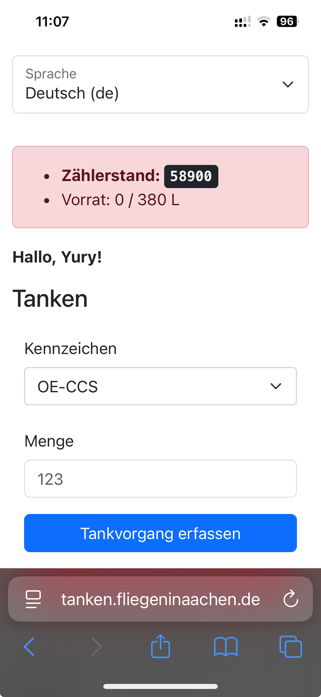
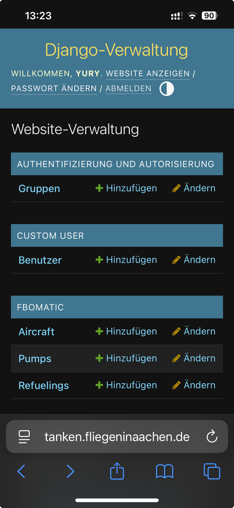

# fbomatic

Provisions for having multiple pumps are currently in place, but they are not actually supported.

 

## Develop

```
./manage.sh makemessages -l de
./manage.sh createsuperuser
./manage.sh makemigrations
./manage.sh makemessages -a
```

## Deploy

```shell
# For passenger
apt install python-is-python3

# For mysqlclient
apt install build-essential pkg-config default-libmysqlclient-dev

# For python manage.py compilemessages
apt install gettext
```

Adjust `fbomatic.env`:

```shell
EMAIL_BACKEND=django.core.mail.backends.smtp.EmailBackend
```

```python
from django.core.management.utils import get_random_secret_key

print(get_random_secret_key())

from urllib.parse import quote

quote("password")
```

## Vendoring

* [Bootstrap](https://getbootstrap.com/docs/5.3/getting-started/introduction/)
* [select2-bootstrap-5-theme](https://apalfrey.github.io/select2-bootstrap-5-theme/) should match Django's Select2 version